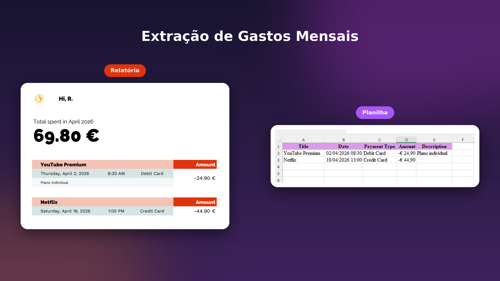

## Sobre o projeto

Esta API foi desenvolvida com **.NET 8** e utiliza os princípios do **Domain-Driven Design (DDD)** para organizar as responsabilidades e as regras de negócio da aplicação. O objetivo do projeto é permitir o gerenciamento de despesas pessoais, com informações como título, data e hora, descrição, valor e tipo de pagamento, armazenadas em um banco de dados **MySQL**.

A API segue o padrão **REST**, disponibilizando endpoints para as operações da aplicação. Para facilitar a exploração e os testes das funcionalidades, o projeto conta com documentação interativa por meio do **Swagger**.

Dentre os pacotes NuGet utilizados, o **AutoMapper** facilita o mapeamento entre objetos da aplicação, reduzindo a necessidade de código repetitivo. O **FluentValidation** é utilizado para definir regras de validação nas requisições, contribuindo para um código mais organizado e de fácil manutenção. Para o acesso ao banco de dados, o **Entity Framework Core**, integrado ao **MySQL** por meio do provedor **Pomelo**, permite manipular os dados utilizando objetos .NET, simplificando as operações de persistência.



### Features

- **Domain-Driven Design (DDD)**: organização da aplicação em camadas, buscando separar as responsabilidades e facilitar a manutenção e a evolução do código.
- **Testes unitários**: testes automatizados com xUnit e Shouldly para verificar o comportamento da aplicação e auxiliar na identificação de possíveis erros.
- **Geração de relatórios**: geração de arquivos **Excel** e documentos **PDF**.
- **API RESTful com Swagger**: disponibilização de endpoints seguindo os princípios REST, com documentação interativa para visualizar e testar as funcionalidades da API.

## Construído com


## Getting Started

Siga as etapas abaixo para configurar e executar o projeto localmente.

### Pré-requisitos

Antes de começar, você precisará ter instalado:

- Visual Studio 2022+ ou Visual Studio Code
- Windows 10+ ou Linux/MacOS com [.NET SDK](https://dotnet.microsoft.com/en-us/download/dotnet/8.0) instalado
- MySql Server

### Instalação

1. Clone o repositório: 
    ```sh
    git clone https://github.com/rhaycf/cashflow.git
    ```
2. Configure a conexão com o banco de dados no arquivo `appsettings.Development.json`
3. Execute a API
